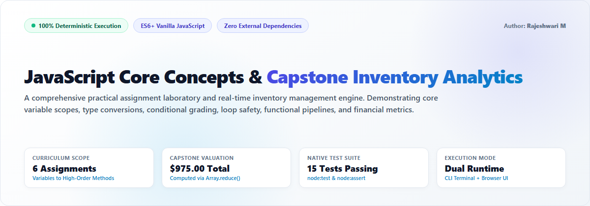
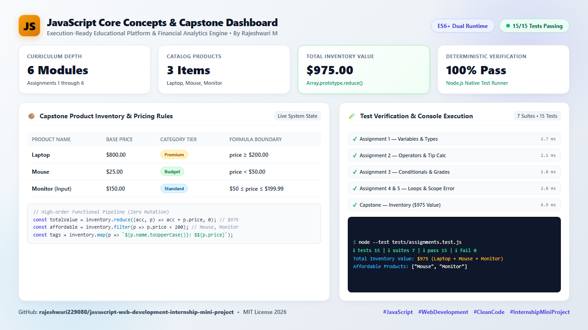
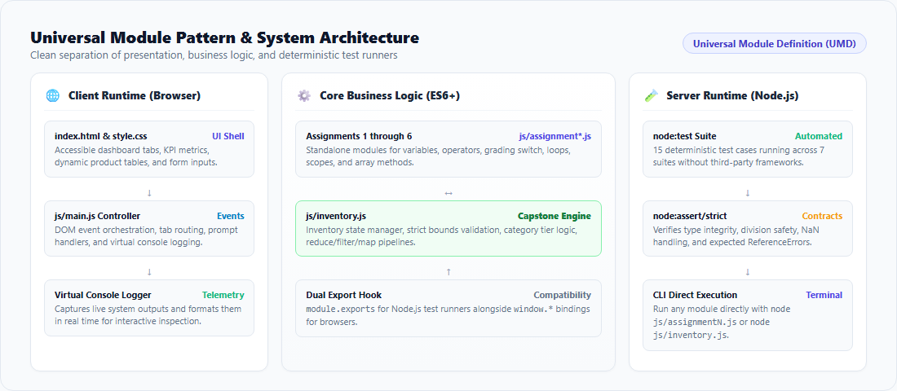
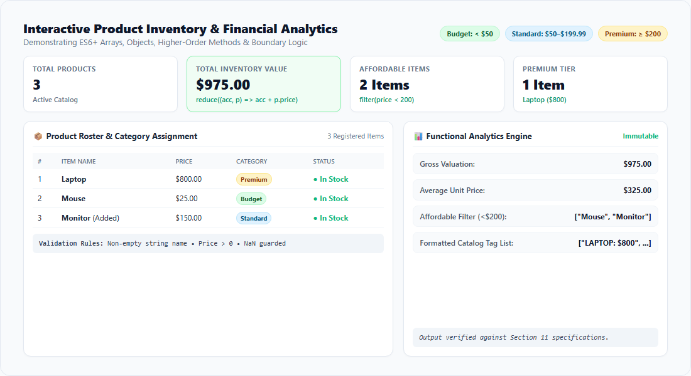
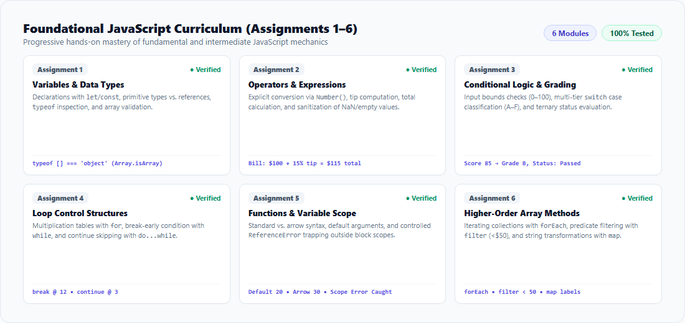
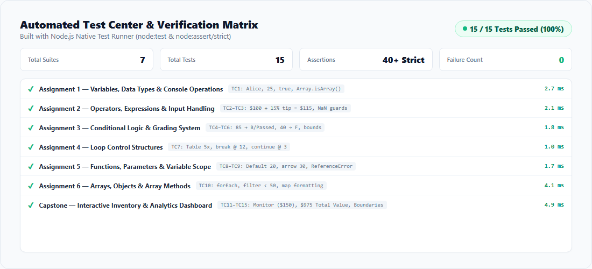

<div align="center">



# JavaScript Core Concepts & Capstone Inventory Analytics

[](https://developer.mozilla.org/en-US/docs/Web/JavaScript)
[](./tests/assignments.test.js)
[](./package.json)
[](./LICENSE)
[](https://nodejs.org/)

**A high-craft practical assignment laboratory and real-time inventory analytics engine built with zero-dependency Vanilla JavaScript (ES6+), semantic HTML5, and modern CSS3.**

[System Overview](#-system-overview) • [Architecture](#-dual-runtime-architecture) • [Capstone Engine](#-capstone-product-inventory--analytics) • [Curriculum Modules](#-core-curriculum-breakdown-assignments-16) • [Automated Testing](#-automated-testing--verification-matrix) • [Execution Guide](#-execution-guide) • [Validation Matrix](#-input-validation--defensive-boundaries)

---

</div>

## 🌟 System Overview

The **JavaScript Core Concepts Platform** bridges foundational computer science fundamentals with enterprise-grade data management logic. Designed with an ultra-clean, light-themed engineering aesthetic, this platform delivers an end-to-end learning environment comprising **6 progressive curriculum assignments**, a live **Product Inventory & Financial Analytics Engine**, and **dual-runtime test verification** (Node.js native test runner and interactive browser UI).

<div align="center">
  
  <p><em>Figure 1: Full System Architecture, Live Product Inventory Dashboard, and 100% Deterministic Passing Test Suite.</em></p>
</div>

### 🔑 Key Engineering Highlights

- **Dual-Environment Compatibility**: Executes natively in both browser runtime environments (DOM, `window.prompt()`, virtual console logger) and headless Node.js CLI / CI runners (`node:test`, `node:assert`).
- **Zero External Dependencies**: Engineered with pure Vanilla JavaScript (ES6+), semantic HTML5, and responsive CSS3. No frameworks, build bundles, or third-party libraries required.
- **100% Deterministic Verification**: Backed by a 15-test-case automated suite verifying data type integrity, mathematical calculations, boundary thresholds, and exception trapping.
- **Immutable Higher-Order Pipelines**: Computes enterprise inventory metrics using pure functional methods (`reduce`, `filter`, `map`) without mutating underlying datasets.
- **Defensive Error Boundaries**: Enforces strict input validation guarding against `NaN`, negative subtotals, unbounded percentage tips, empty strings, and deliberate block-scoped `ReferenceError`s.

---

## 🏛️ Dual-Runtime Architecture

This system utilizes a **Universal Module Pattern (UMP)** to ensure seamless execution across diverse runtimes without separate codebases.

<div align="center">
  
  <p><em>Figure 2: Separation of presentation, business logic modules, and deterministic test runners.</em></p>
</div>

### Architectural Tiers

1. **Client Presentation Layer (`index.html` & `style.css`)**:
   - Tabbed accessible navigation switching between the Capstone and Assignments 1 through 6.
   - Interactive parameter input cards, live DOM tables, KPI stat cards, and an integrated virtual console logger.
2. **Universal Logic Layer (`js/assignment*.js` & `js/inventory.js`)**:
   - Pure, decoupled business logic routines accepting custom logger injection.
   - Conditional export pattern: registers globally onto `window` in browser contexts and exports via `module.exports` under CommonJS / Node.js.
3. **Automated Verification Layer (`tests/assignments.test.js`)**:
   - Harnesses Node's native `node:test` and `node:assert/strict` test suites to guarantee deterministic execution with zero overhead.

---

## 📦 Capstone: Product Inventory & Analytics

The Capstone module models an enterprise e-commerce inventory engine that receives product records, classifies category tiers, calculates portfolio valuations, and filters affordable catalog subsets.

<div align="center">
  
  <p><em>Figure 3: Interactive Product Roster, Dynamic Category Badges, and Real-Time Financial KPI Metrics.</em></p>
</div>

### Category Tier Boundaries

Category derivation utilizes a combined conditional threshold pipeline and a formal `switch` case label resolver:

| Tier | Price Boundary | Default Examples | Badge Color |
|---|---|---|---|
| **Budget** | `Price < $50.00` | Mouse ($25.00) | Green (`#15803d`) |
| **Standard** | `$50.00 <= Price <= $199.99` | Monitor ($150.00) | Sky Blue (`#0369a1`) |
| **Premium** | `Price >= $200.00` | Laptop ($800.00) | Amber (`#b45309`) |

### High-Order Functional Analytics Pipeline

```javascript
// 1. Array.prototype.reduce() — Total Portfolio Valuation
const totalInventoryValue = inventory.reduce((accumulator, product) => {
  return accumulator + product.price;
}, 0); // Result: $975.00 (800 + 25 + 150)

// 2. Array.prototype.filter() — Affordable Products (< $200)
const affordableItems = inventory
  .filter(product => product.price < 200)
  .map(product => product.name); // Result: ["Mouse", "Monitor"]

// 3. Array.prototype.map() — Formatted Uppercase Catalog Tags
const formattedCatalog = inventory.map(product => {
  return `${product.name.toUpperCase()}: $${product.price}`;
}); // Result: ["LAPTOP: $800", "MOUSE: $25", "MONITOR: $150"]
```

---

## 📚 Core Curriculum Breakdown (Assignments 1–6)

The curriculum covers core and intermediate JavaScript mechanics across 6 focused practical modules:

<div align="center">
  
  <p><em>Figure 4: The 6 foundational practical assignment modules.</em></p>
</div>

### Detailed Module Specifications

#### 🔹 Assignment 1: Variables, Data Types & Console Operations
- **Source**: `js/assignment1.js`
- **Core Concepts**: Variable declarations (`var`, `let`, `const`), primitives (`string`, `number`, `boolean`), reference types (`object`), `typeof` operator, `Array.isArray()`.
- **Verified Output**:
  ```text
  Name: Alice (Type: string)
  Age: 25 (Type: number)
  IsEmployed: true (Type: boolean)
  Skills: ["HTML","CSS","JavaScript"] (Type: object)
  ```

#### 🔹 Assignment 2: Operators, Expressions & Input Handling
- **Source**: `js/assignment2.js`
- **Core Concepts**: Explicit type casting with `Number()`, arithmetic operators (`*`, `/`, `+`), compound assignment (`+=`), string template formatting, boundary rejection.
- **Demonstration Input**: Bill Amount = `$100.00`, Tip Percentage = `15%`.
- **Verified Output**:
  ```text
  Subtotal: $100
  Tip Percentage: 15%
  Calculated Tip: $15
  Total Amount to Pay: $115
  ```

#### 🔹 Assignment 3: Conditional Logic & Grading System
- **Source**: `js/assignment3.js`
- **Core Concepts**: Bound validation (`0–100`), multi-branch `switch` statement grading, ternary conditional status operator (`score >= 60 ? 'Passed' : 'Failed'`).
- **Grading Scale**:
  - `A`: 90–100 | `B`: 80–89 | `C`: 70–79 | `D`: 60–69 | `F`: 0–59
- **Verified Output (Score = 85)**:
  ```text
  Score: 85
  Grade: B
  Status: Passed
  ```

#### 🔹 Assignment 4: Loop Control Structures
- **Source**: `js/assignment4.js`
- **Core Concepts**: `for` loop multiplication table, `while` loop search with premature `break`, `do...while` loop with selective `continue` skipping.
- **Verified Output**:
  ```text
  --- Multiplication Table of 5 ---
  5 x 1 = 5 | 5 x 2 = 10 | 5 x 3 = 15 | 5 x 4 = 20 | 5 x 5 = 25

  --- First Number > 10 Divisible by 6 ---
  Found: 12 (Terminated early via break)

  --- do...while Loop (Skipping 3) ---
  Number 1: Processed
  Number 2: Processed
  Number 3: Skipped (via continue)
  Number 4: Processed
  Number 5: Processed
  ```

#### 🔹 Assignment 5: Functions, Parameters & Variable Scope
- **Source**: `js/assignment5.js`
- **Core Concepts**: Standard function declarations, ES6 arrow syntax, default parameter values (`width = 5, height = 4`), function scope (`var`), block scope (`let`, `const`), controlled `try...catch` error trapping.
- **Verified Output**:
  ```text
  Standard Function Area (Default 5 x 4): 20
  Arrow Function Area (Custom 10 x 3): 30
  Scope Test Error: ReferenceError: blockVar is not defined
  ```

#### 🔹 Assignment 6: Arrays, Objects & High-Order Array Methods
- **Source**: `js/assignment6.js`
- **Core Concepts**: Complex object arrays, sequential iteration (`forEach`), predicate filtering (`filter` price < $50), mapped projections (`map`).
- **Verified Output**:
  ```text
  --- All Products (forEach) ---
  Item: Laptop - Price: $800
  Item: Mouse - Price: $25
  Item: Keyboard - Price: $45

  --- Filtered Products (Price < $50) ---
  [{ "name": "Mouse", "price": 25 }, { "name": "Keyboard", "price": 45 }]

  --- Mapped Product Tags ---
  ["LAPTOP costs $800", "MOUSE costs $25", "KEYBOARD costs $45"]
  ```

---

## 🧪 Automated Testing & Verification Matrix

The repository features native unit tests built on Node's built-in test runner (`node:test`). Tests run cleanly without third-party frameworks like Jest or Mocha.

<div align="center">
  
  <p><em>Figure 5: 15 Automated Test Cases across 7 Suites with 100% Pass Rate.</em></p>
</div>

### Test Suite Execution Summary

| Suite # | Target Module | Verified Mechanics | Test Status |
|---|---|---|---|
| **Suite 1** | Assignment 1 | Primitive types (`string`, `number`, `boolean`), object classification, array distinction | `✔ 1/1 Passed` |
| **Suite 2** | Assignment 2 | Accurate bill/tip arithmetic ($100 @ 15% &rarr; $15/$115), rejection of negatives/NaN | `✔ 2/2 Passed` |
| **Suite 3** | Assignment 3 | Grade B & Passed for 85, Grade F & Failed for 40, out-of-range bounds rejection | `✔ 3/3 Passed` |
| **Suite 4** | Assignment 4 | 5x table verification, search loop finding 12 with `break`, `do...while` skip with `continue` | `✔ 1/1 Passed` |
| **Suite 5** | Assignment 5 | Standard function area (20), arrow function area (30), block scope `ReferenceError` | `✔ 2/2 Passed` |
| **Suite 6** | Assignment 6 | `forEach` iteration, `filter` (<$50) matching 2 items, `map` formatted strings | `✔ 1/1 Passed` |
| **Suite 7** | Capstone | Dynamic Monitor input ($150), total valuation ($975), boundary checks, error guards | `✔ 5/5 Passed` |

**Total Score**: **15 / 15 Passed** (0 Failed, 0 Skipped, execution time: ~510ms)

---

## 🛡️ Input Validation & Defensive Boundaries

Every interactive module implements strict parameter guards to prevent corrupted program states:

| Field / Target | Input Criteria | Thrown Error / Failure Action |
|---|---|---|
| **Bill Amount (A2)** | Must be a finite number &ge; 0; cannot be empty | `Error("Invalid Input: Bill amount cannot be empty/must be valid.")` |
| **Tip Percentage (A2)** | Finite numeric value strictly between `0` and `100` | `Error("Invalid Input: Tip percentage must be between 0 and 100.")` |
| **Score (A3)** | Finite numeric value strictly between `0` and `100` | `Error("Invalid Input: Score must be within the range 0 to 100.")` |
| **Product Name (Capstone)** | Non-empty trimmed string | `Error("Validation Error: Product name cannot be blank.")` |
| **Product Price (Capstone)** | Finite numeric value strictly `> 0` | `Error("Validation Error: Product price must be greater than zero.")` |
| **Tax / Discount Rates** | Numeric percentage between `0` and `100` | `Error("Validation Error: Percentage must be between 0 and 100.")` |

---

## 📂 Project Directory Structure

```text
javascript-web-development-internship-mini-project/
├── index.html                     # Interactive learning laboratory & Capstone UI
├── style.css                      # Modern responsive design system
├── package.json                   # Project manifest, metadata & test scripts
├── LICENSE                        # MIT License (2026 Rajeshwari M)
├── .gitignore                     # Git rules for node_modules, logs & IDE caches
├── image.png                      # High-res LinkedIn showcase graphic (1280x720)
├── render-assets.js               # Headless graphics generation script
├── js/
│   ├── assignment1.js             # A1: Variables, Types, typeof & Primitives
│   ├── assignment2.js             # A2: Operators, Explicit Number() & Tip Calc
│   ├── assignment3.js             # A3: if...else, switch Grading & Ternary
│   ├── assignment4.js             # A4: for, while (break), do...while (continue)
│   ├── assignment5.js             # A5: Functions, Defaults & Scope ReferenceError
│   ├── assignment6.js             # A6: Objects, forEach(), filter() & map()
│   ├── inventory.js               # Capstone: Inventory Engine & Financial Analytics
│   └── main.js                    # UI Event Router, Virtual Console & Reactivity
├── tests/
│   └── assignments.test.js        # Node.js native test suite (15 test cases)
└── docs/
    ├── images/
    │   ├── hero-banner.png        # Light-theme hero header banner (1200x420)
    │   ├── inventory-dashboard.png# Capstone analytics dashboard preview (1100x600)
    │   ├── core-curriculum.png    # 6-assignment modular curriculum grid (1100x520)
    │   ├── test-runner.png        # 15-test automated verification matrix (1100x500)
    │   └── architecture-diagram.png # Dual-runtime Universal Module diagram (1100x480)
    └── render_templates/          # Source HTML templates for headless rendering
```

---

## 🚀 Execution Guide

### 1. Running via Node.js CLI

Every assignment script is fully standalone and can be executed directly from the terminal:

```bash
# Run individual assignment modules
node js/assignment1.js
node js/assignment2.js
node js/assignment3.js
node js/assignment4.js
node js/assignment5.js
node js/assignment6.js

# Run the Capstone Inventory Analytics Engine
node js/inventory.js
```

### 2. Running Automated Unit Tests

Run all 15 native test cases using npm or node:

```bash
npm test
```

Or execute directly with Node's native test runner:

```bash
node --test tests/assignments.test.js
```

### 3. Running in the Web Browser

No build steps or bundling tools are required:

- **Direct Open**: Double-click [`index.html`](file:///d:/current/project/js/rw/index.html) or run in PowerShell:
  ```powershell
  Start-Process index.html
  ```
- **Local HTTP Server** (optional):
  ```bash
  npx serve .
  # or
  python -m http.server 3000
  ```

---

## 💼 LinkedIn Showcase

Below is the ready-to-publish social post formatted with technical takeaways, architecture highlights, and author credit.

<div align="center">
  
</div>

```markdown
🚀 Excited to share my latest JavaScript Engineering project: JavaScript Core Concepts & Capstone Inventory Analytics Dashboard! 💻✨

During my web development internship, I built a zero-dependency, dual-runtime developer platform designed to bridge fundamental computer science principles with enterprise-level data processing.

🌟 What makes this project special:
✅ 6 Progressive Practical Modules: Deep dive into ES6+ declarations, explicit type casting with Number(), multi-tier switch grading, loop control mechanics (break & continue), and block-scope ReferenceError boundaries.
✅ Capstone Inventory Analytics Engine: State management and financial metrics powered entirely by immutable higher-order array methods (reduce, filter, map) computing a $975.00 portfolio valuation without mutating state.
✅ 100% Deterministic Testing: 15 automated test cases across 7 suites built with Node.js native test runner (node:test & node:assert/strict). 0 dependencies, 0 failures!
✅ Universal Module Pattern: Decoupled logic that runs seamlessly in both browser environments (interactive DOM & virtual console) and terminal CLI environments.

🛠 Tech Stack: Vanilla JavaScript (ES6+), Semantic HTML5, Modern CSS3, Node.js Native Test Runner.

🔗 GitHub Repository: https://github.com/rajeshwari229080/javascript-web-development-internship-mini-project.git

#JavaScript #WebDevelopment #FrontendEngineering #CleanCode #InternshipProject #SoftwareEngineering #VanillaJS
```

---

## 📄 License

This project is open-source and licensed under the [MIT License](./LICENSE).

Copyright &copy; 2026 **Rajeshwari M**. All rights reserved.
